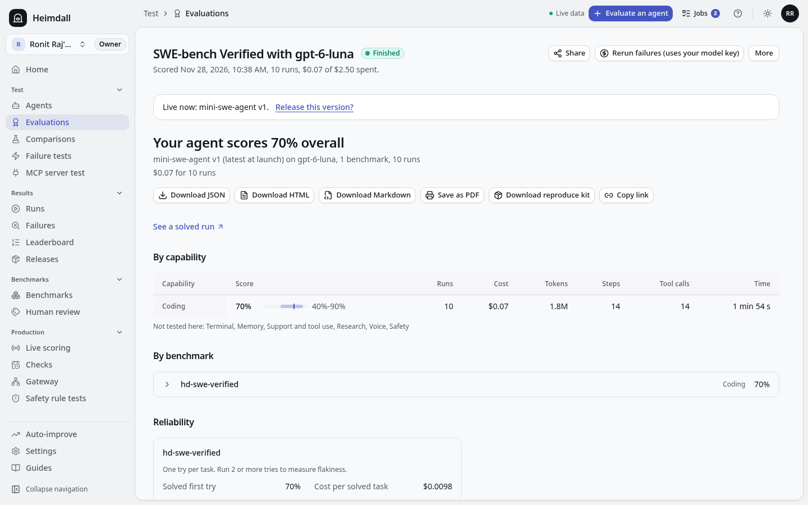
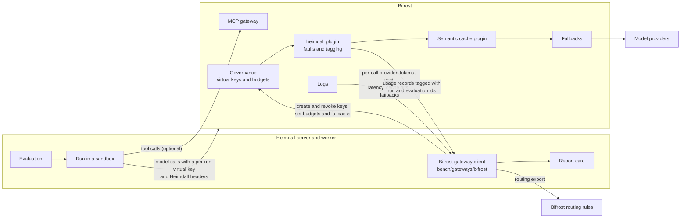
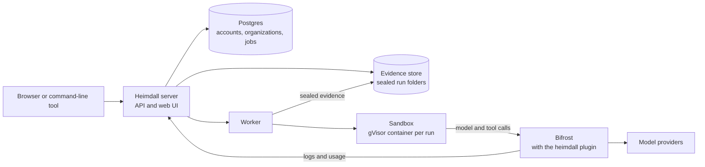

# Heimdall

Heimdall is a release gate for agent changes that pass through Bifrost: it runs your real agent through Bifrost with the change, injects gateway faults on purpose (through its own Bifrost plugin, or through a fault proxy behind Bifrost), and says better, worse, or too early to tell.

Built by Ronit Raj for the Geek Room x Maxim hackathon, Problem Statement 2 (agent benchmarking platform). This repository is a fork of [Bifrost](https://github.com/maximhq/bifrost); Heimdall lives in `bench/` and `plugins/heimdall/`.

## Contents

- [What is different](#what-is-different)
- [Screenshots](#screenshots)
- [See it in 30 seconds](#see-it-in-30-seconds)
- [Run it locally in 5 minutes](#run-it-locally-in-5-minutes)
- [How Heimdall uses Bifrost](#how-heimdall-uses-bifrost)
- [Architecture](#architecture)
- [Tests and CI](#tests-and-ci)
- [Results](#results)
- [Production](#production)
- [Repo layout](#repo-layout)
- [Security, contributing and changelog](#security-contributing-and-changelog)
- [Credits and license](#credits-and-license)

## What is different

- **Verdicts that can say "too early to tell".** Two versions of an agent run on the same tasks, and an exact paired test decides better, worse, or too early to tell. A small sample never passes as a win.
- **Faults injected at the gateway.** Error codes, rate limits, timeouts, latency and outage windows are injected on the model calls that pass through Bifrost, so the agent meets the failures it will meet in production. With `HEIMDALL_FAULT_MODE=plugin` the `plugins/heimdall` Bifrost plugin injects them inside the gateway; the default hosted setup, the live site included, injects them through a fault proxy behind Bifrost.
- **Every task proven by controls before it counts.** A task joins a benchmark only after its official solution passes and empty, wrong and cheating answers fail.

## Screenshots

Screenshots: coming with the next push.

<!-- The files below are added with the next push.



-->

## See it in 30 seconds

Open the live site: https://20-70-160-61.sslip.io. Sign up with GitHub or an email, add a model key under Settings, connect an agent and read its report card.

## Run it locally in 5 minutes

Prerequisites:

- For the demo: Docker 24 or later with Compose v2.
- For development: Go 1.26 (`bench/go.mod`), Go 1.27.3 (`plugins/heimdall/go.mod`) and Node 26 (`.nvmrc`).

From the repository root:

```sh
docker compose up --build
```

Then open http://localhost:8090. No keys are needed and nothing runs: the demo serves recorded data only.

The first screen is the home page with the "Recorded data" mode banner. Comparisons lists "pilot-mixed" (`e_pilot_mixed_nc93`, a real experiment: Codex CLI against the custom-python agent on gpt-5.4-mini through Bifrost v2.5.1, 10 sealed runs, $0.172) and the synthetic smoke experiment, labelled synthetic. Opening pilot-mixed shows the verdict "Too early to tell" (5 tasks, 1 run each), each run's steps, and the Through Bifrost panel from the recorded gateway rows.

A cold build takes about 10 to 15 minutes, because the UI and Go builds run inside Docker. Later starts take seconds.

## How Heimdall uses Bifrost

Every model call an agent makes during an evaluation crosses Bifrost, and Heimdall uses Bifrost's own features to control, break and measure that traffic.



| Bifrost feature | What Heimdall does with it | Where |
|---|---|---|
| Governance virtual keys and budgets | One virtual key per run, minted before and revoked after; the evaluation's spending limit becomes a hard Bifrost budget | [`bench/gateways/bifrost/keys.go`](bench/gateways/bifrost/keys.go) |
| Plugin `PreLLMHook` and `PostLLMHook` | The heimdall plugin tags every call with its run and evaluation; in plugin fault mode (`HEIMDALL_FAULT_MODE=plugin`) it also injects the planned faults inside the gateway. The default is a fault proxy behind Bifrost | [`plugins/heimdall/`](plugins/heimdall/) |
| Fallbacks | "Provider failover" takes the primary down on purpose and reports whether failover worked, its latency and cost | [`bench/faults/`](bench/faults/) |
| Semantic cache | "Bifrost cache on vs off" runs two setups that differ only in the cache and reports hit rate, latency, cost and quality. Needs a gateway with the semantic cache plugin loaded; the gateway of the live site has none | [`bench/docs/bifrost-features.md`](bench/docs/bifrost-features.md) |
| MCP gateway | A task's MCP tool servers can go through Bifrost, so tool calls appear in its logs next to model calls | [`bench/mcptest/`](bench/mcptest/) |
| Logs API and gateway request rows | The Through Bifrost panel on every run lists provider, model, fallbacks, cache hits, faults, tokens, cost and latency per call | [`bench/traceinbox/`](bench/traceinbox/) |
| Routing export | "Use this in Bifrost" shows the winning setting of a finished test as text to copy into your own gateway. Heimdall never writes to a gateway | [`bench/gateways/bifrost/`](bench/gateways/bifrost/) |
| `x-bf-*` headers | Each run's requests carry Bifrost's headers for the features under test | [`bench/docs/bifrost-features.md`](bench/docs/bifrost-features.md) |
| Prompt and skills repositories | A prompt version or a skill version kept in Bifrost can be a test arm, and a skill version can be imported into an agent (Gateway page, with your own Bifrost connected) | [`bench/gwfeature/`](bench/gwfeature/) |

Every touchpoint with file paths and sequence diagrams: [`bench/docs/bifrost-integration.md`](bench/docs/bifrost-integration.md).

## Architecture



The server serves the API and the UI and schedules evaluations. Workers run each agent in its own sandbox with controlled egress; every model call goes through Bifrost with a per-run virtual key. Each finished run is sealed (a hash of every file) in the evidence store, and the report card is computed from the sealed evidence only.

## Tests and CI

At the time of writing: 1,896 Go test files under `bench/`, 749 UI test files under `bench/ui/` and 3 Go test files in `plugins/heimdall/`.

```sh
cd bench && GOWORK=off go vet ./... && GOWORK=off go test -count=1 ./...
cd plugins/heimdall && GOWORK=off go test -count=1 ./...
cd bench/ui && npm ci && npm run build && npx vitest run
```

[`.github/workflows/heimdall-ci.yml`](.github/workflows/heimdall-ci.yml) runs on pushes to `main` and on pull requests: the Go tests of `bench/` in three shards with `go vet`, the plugin's tests, the UI build (route tree and type check) and its tests, `gofmt` and golangci-lint on new code, oxfmt on changed UI files, the server and plugin Docker builds (never pushed), a check of both compose files, and a gitleaks secret scan. [`.github/workflows/bench-check.yml`](.github/workflows/bench-check.yml) is Heimdall's own release gate: it replays a sealed, checked-in experiment with no Docker, gateway or provider key and fails on a blocking verdict. Bifrost's upstream workflows are kept in `.github/workflows-upstream/` and do not run.

## Results

Six experiments on a real model (gpt-5.4-mini on OpenAI through stock Bifrost v2.5.1, 8 coding tasks, Codex CLI and the custom-python agent), 318 sealed runs, $8.08 in total. With 8 tasks most comparisons are too early to tell; these runs show the pipeline end to end, not a ranking of agents.

| Experiment | Question | Runs | Spend | Verdict |
|---|---|---:|---:|---|
| `e_pilot_codex_elat` | Cost and minutes per run before sizing the batch | 4 | $0.08 | too early to tell |
| `e_pilot_mixed_nc93` | One run of each path: custom-python on OpenAI, Codex under each fault | 10 | $0.17 | too early to tell |
| `e_batch_frameworks_9z0h` | Codex against a no-framework agent, clean and under three failure families | 128 | $3.08 | worse (hold) |
| `e_batch_seeded_regression_ik2t` | Can the gate catch a seeded regression on real runs? | 48 | $1.20 | too early to tell |
| `e_batch_codewins_f8f7` | Does a "code is the source of truth" note resist stale notes? | 64 | $1.82 | too early to tell |
| `e_memory_trap_wn4b` | Does a memory hygiene sentence stop acting on a planted note? | 64 | $1.73 | too early to tell |

Details, the post-hoc regate and how to re-check: [`bench/docs/results/`](bench/docs/results/README.md).

## Production

- Hosting, every setting and the hardening checklist: [`bench/docs/hosting.md`](bench/docs/hosting.md).
- Monitoring and alerts: [`bench/docs/monitoring.md`](bench/docs/monitoring.md).
- Backups, restore drills and other operations: [`bench/docs/operations.md`](bench/docs/operations.md).
- Upgrades: [`bench/docs/hosting.md`, section 8](bench/docs/hosting.md#8-upgrades).

The command-line tool is `heimdall`; older builds call it `bifrost-bench`.

## Repo layout

Only `bench/` and `plugins/heimdall/` are Heimdall. The rest is upstream Bifrost.

| Path | What |
|---|---|
| [`bench/`](bench/) | Heimdall: server, workers, runners, graders, statistics, importers, the web UI ([`bench/ui/`](bench/ui/)) and docs ([`bench/docs/`](bench/docs/)) |
| [`bench/gateways/bifrost/`](bench/gateways/bifrost/) | Heimdall's Bifrost client: virtual keys, budgets, logs, routing, MCP |
| [`plugins/heimdall/`](plugins/heimdall/) | The Heimdall Bifrost plugin: fault injection, tagging, usage export |
| [`bench/deploy/`](bench/deploy/) | Local, demo and hosted Docker Compose stacks, Bifrost config, the plugin image |
| `core/`, `transports/`, `framework/`, `ui/`, other `plugins/` | Bifrost itself |

## Security, contributing and changelog

- Security: [`bench/SECURITY.md`](bench/SECURITY.md).
- Contributing: [`bench/CONTRIBUTING.md`](bench/CONTRIBUTING.md).
- Changelog: [`bench/CHANGELOG.md`](bench/CHANGELOG.md).
- Repository upkeep for the owner: [`bench/docs/repo-maintenance.md`](bench/docs/repo-maintenance.md).

## Credits and license

Heimdall is built by [Ronit Raj](https://github.com/Ronit-Raj9). This repository is a fork of [Bifrost](https://github.com/maximhq/bifrost), the AI gateway by Maxim AI: the gateway code under `core/`, `transports/`, `framework/`, `ui/` and the built-in plugins is theirs, and its own documentation is in the [upstream README](https://github.com/maximhq/bifrost#readme). Heimdall development started on 14 Nov 2026; earlier commits in this repository are Bifrost's own history.

Apache-2.0, see [LICENSE](LICENSE).
