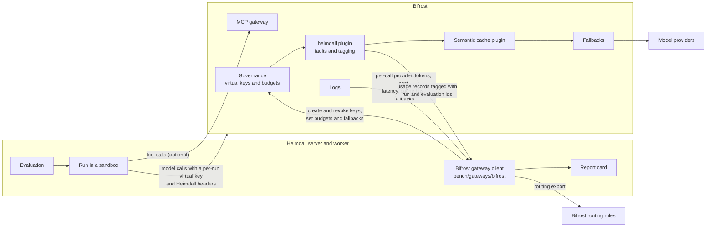

# Heimdall: a report card for your AI agent

Heimdall is an agent benchmarking platform. You connect the agent you actually ship, run it on real tasks, break it on purpose, and get a report card you can trust: a score with a range, cost per solved task, how it holds up under failures, and why it failed. Every model call an agent makes goes through the [Bifrost](https://github.com/maximhq/bifrost) gateway, which Heimdall uses to control, break and measure that traffic.

**Live site: https://20-70-160-61.sslip.io**

Built by Ronit Raj for the Geek Room x Maxim hackathon, Problem Statement 2 (agent benchmarking platform).

Others score a model's answers. Heimdall tests the whole agent, breaks it, and tests the tests first.

## What it does

| | |
|---|---|
| **Connect any agent** | An HTTP endpoint, an OpenAI-compatible endpoint, a repository, a Docker image, a CLI coding agent (Codex, Claude Code, OpenCode, Gemini CLI, mini-swe-agent), an A2A agent, a framework agent (LangGraph, CrewAI, OpenAI Agents SDK and others) or a voice agent. Paste it; Heimdall detects the type, verifies it and gives a first report card. |
| **A library of tested benchmarks** | 1,100+ ready tasks across 57 benchmarks (SWE-bench Verified, SWE-rebench, Terminal-Bench, tau2, BFCL, AgentDojo, WebArena-Pro, LongMemEval, GAIA and more). A task is ready only after its official solution passes and empty, wrong and cheating answers fail. |
| **Benchmarks from your own work** | Turn fixed GitHub issues, production traces, a policy document, an OpenAPI spec, rows or a folder into a private benchmark. Nothing joins until you accept it. |
| **Break it on purpose** | 15+ faults (model outage, rate limits, slow or flaky provider, broken tools, schema drift, expired login, process kill, tight budget) and an adaptive red team. Every successful attack becomes a regression test. |
| **One report card per version** | Score with a confidence interval, cost per solved task, reliability, resilience per fault, safety, and the failure patterns behind the score. Version against version on the same tasks, with a verdict: better, worse, or too early to tell. |
| **Ship with a gate, then keep watching** | Release gates, checks on pull requests (GitHub, GitLab), scheduled checks, live monitors and alerts to Slack, Teams, PagerDuty and email. |
| **More than chat** | Desktop and browser agents with video recordings, voice agents, memory over long tasks, multi-agent teams, GPU tasks, and a self-improvement test that keeps a change only when it is really better on tasks the agent never saw. |

## Try it in the browser

No install. Everything happens on the live site, in an organization of your own.

1. **Sign up.** Open https://20-70-160-61.sslip.io and press **Continue with GitHub**, or create an account with an email and a password. You get your own organization with you as owner.
2. **Add a model key.** **Settings, API keys**: paste a key for the provider you want to test with and press **Test**. Runs use only your organization's own keys, stored encrypted.
3. **Connect your agent.** Press **Evaluate an agent**, then paste an endpoint URL, a curl command, a repository, an image or a platform id and press **Detect**. Or pick a built-in agent under **My agents**.
4. **Pick benchmarks.** Choose from **Benchmarks**, pick a preset (Quick look, Standard, Thorough) and, if you like, faults. The estimate shows runs, cost and time before you launch, and your spending limit is enforced.
5. **Read the report card.** Score with its range, cost, how the agent held up under each fault, and every run one click away. **Share** gives a read-only link.

Other pages worth opening: **Comparisons** (version against version), **Failure tests**, **Why agents fail**, **Improvements**, **Releases**, **Test my MCP server**, and **Settings, Integrations** (the Bifrost features your organization uses).

Guides ship inside the app under **Docs**; the same files are in [`bench/docs/`](bench/docs/web-quickstart.md).

## How Heimdall uses Bifrost

Bifrost is not a side dependency: every model call an agent makes during an evaluation crosses Bifrost, and Heimdall uses Bifrost's own features to control, break and measure that traffic.



- **One virtual key per run.** Each run gets its own Bifrost governance virtual key, minted before the run and revoked after it, so every call belongs to exactly one run ([`bench/gateways/bifrost/keys.go`](bench/gateways/bifrost/keys.go)).
- **Budgets enforced by Bifrost.** The evaluation's spending limit becomes a hard Bifrost budget. When Bifrost refuses a call for budget, the evaluation says "stopped by Bifrost budget".
- **The Heimdall Bifrost plugin** ([`plugins/heimdall/`](plugins/heimdall/)). A real Bifrost plugin. Its `PreLLMHook` injects the planned model faults inside the gateway (error codes, 429 with Retry-After, timeouts, latency, seeded flaky failures, outage windows); its `PostLLMHook` tags every call and log row with the run and evaluation ids; it can send per-call usage (provider, model, tokens, cost, latency, cache hit, fallback, fault) back to Heimdall. The live site's gateway runs a Bifrost build with this plugin. The fault proxy ([`bench/faultproxy/`](bench/faultproxy/)) is the fallback when the plugin is not loaded.
- **Failover as a test.** "Provider failover" sets Bifrost fallbacks for the agent's model, takes the primary down on purpose, and reports whether failover worked, the extra latency, the cost change and task success with and without it.
- **Cache as a test.** "Bifrost cache on vs off" runs two setups that differ only in Bifrost's semantic cache and reports hit rate, latency and cost saved, and any change in quality.
- **MCP gateway.** A task's MCP tool servers can go through Bifrost's MCP gateway, so tool calls appear in Bifrost's logs next to model calls.
- **Logs joined to runs.** The "Through Bifrost" panel on every run lists provider and model, fallbacks, cache hits, faults, tokens, cost and latency per call.
- **Model switch and routing export.** Run one agent on 2 to 6 models through Bifrost, compare quality, cost and speed, then "Apply to my Bifrost" writes the winning routing rules to your own gateway.

Every touchpoint with file paths and sequence diagrams: [`bench/docs/bifrost-integration.md`](bench/docs/bifrost-integration.md). What each Bifrost feature does under test: [`bench/docs/bifrost-features.md`](bench/docs/bifrost-features.md).

## Run it yourself

### Local developer stack

Needs Go, Node.js and Docker. From the repository root:

```sh
make bench-up       # build images and start the gateway stack (Bifrost, fault proxy)
make bench-smoke    # a no-key run end to end through real Bifrost
make bench-serve    # web UI and API
```

`make bench-test` runs `go vet` and the unit tests with no Docker and no network. Start with [`bench/README.md`](bench/README.md) and [`bench/docs/quickstart.md`](bench/docs/quickstart.md).

### Hosted stack with Docker Compose

The hosted stack (Caddy with HTTPS, the Heimdall server with the UI embedded, Postgres, Bifrost, the fault proxy, an image registry and a shared worker) is in [`bench/deploy/hosted/`](bench/deploy/hosted/):

```sh
cd bench
deploy/hosted/bootstrap.sh --domain heimdall.example.com --email ops@example.com \
    --owner-email you@example.com --owner-name "Your Name"
```

`bootstrap.sh` creates `deploy/hosted/.env` with random secrets, builds the server image, migrates the database, creates the first owner and starts the stack; it is safe to run again. Later updates: `deploy/hosted/upgrade.sh` (backs up, drains running evaluations, rebuilds, restarts). The shared worker runs agents under gVisor: `sudo sh deploy/hosted/install-gvisor.sh` once per host. Full guide, every setting: [`bench/docs/hosting.md`](bench/docs/hosting.md).

### Bifrost with the Heimdall plugin

The stock Bifrost image has no Heimdall plugin, so it is an opt-in build from this repository:

```sh
cd bench/deploy/hosted
docker compose -f docker-compose.yml -f docker-compose.bifrost-plugin.yml \
    --profile shared-runner up -d --build bifrost
```

It builds [`bench/deploy/bifrost/Dockerfile.plugin`](bench/deploy/bifrost/Dockerfile.plugin) and mounts [`config.plugin.json`](bench/deploy/bifrost/config.plugin.json). To check the plugin against a real gateway build with a mock provider: `HTTP=1 bench/deploy/bifrost/e2e/run.sh` (call 1 is rate limited inside Bifrost and never reaches the provider; call 2 passes through).

## Use it from a terminal, CI or your editor

The same binary is the server and the command line tool (`bifrost-bench`, also built as `heimdall`). The site serves ready builds under **Downloads**.

```sh
heimdall login -url https://20-70-160-61.sslip.io   # sign this machine in (approve in the browser)
heimdall connect https://my-agent.example.com      # connect an agent and run a first look
heimdall eval run ...                              # evaluate over many benchmarks
heimdall add ./my-benchmark-folder                 # add a benchmark from a file, folder, URL or Harbor id
heimdall ci evaluate                               # pull-request gate
```

- Commands and their website buttons: [`bench/docs/CLI_WEB_PARITY.md`](bench/docs/CLI_WEB_PARITY.md) and [`bench/docs/connect-cli.md`](bench/docs/connect-cli.md).
- API v1 with OpenAPI, and the Python and TypeScript clients ([`bench/clients/`](bench/clients/)): [`bench/docs/api-v1.md`](bench/docs/api-v1.md), [`bench/docs/clients.md`](bench/docs/clients.md).
- MCP server for Cursor, Claude Code and other editors: [`bench/docs/mcp-server.md`](bench/docs/mcp-server.md).
- Checks on pull requests: [`bench/docs/ci.md`](bench/docs/ci.md).

## Guides

| Topic | Guide |
|---|---|
| Connect an agent | [`adding-an-agent.md`](bench/docs/adding-an-agent.md), [`frameworks.md`](bench/docs/frameworks.md), [`pull-agents.md`](bench/docs/pull-agents.md), [`voice-agents.md`](bench/docs/voice-agents.md) |
| Evaluations and the report card | [`evaluations.md`](bench/docs/evaluations.md), [`leaderboard.md`](bench/docs/leaderboard.md), [`releases.md`](bench/docs/releases.md) |
| Add or build a benchmark | [`add-benchmark.md`](bench/docs/add-benchmark.md), [`tasks-from-your-repo.md`](bench/docs/tasks-from-your-repo.md), [`tasks-from-traces.md`](bench/docs/tasks-from-traces.md), [`tasks-from-api.md`](bench/docs/tasks-from-api.md) |
| Faults, red team and safety | [`red-team.md`](bench/docs/red-team.md), [`safety-probes.md`](bench/docs/safety-probes.md), [`adapter-faults.md`](bench/docs/adapter-faults.md) |
| Self-improvement and learning | [`improvement-runs.md`](bench/docs/improvement-runs.md), [`learning-over-time.md`](bench/docs/learning-over-time.md) |
| Desktop, browser and voice | [`computer-use.md`](bench/docs/computer-use.md), [`browser-tasks.md`](bench/docs/browser-tasks.md), [`recordings.md`](bench/docs/recordings.md), [`voice-realtime.md`](bench/docs/voice-realtime.md) |
| Grading you can trust | [`verifiers.md`](bench/docs/verifiers.md), [`judge-calibration.md`](bench/docs/judge-calibration.md), [`evidence-integrity.md`](bench/docs/evidence-integrity.md), [`held-out-and-canaries.md`](bench/docs/held-out-and-canaries.md) |
| Your own compute and GPUs | [`runners.md`](bench/docs/runners.md), [`remote-execution.md`](bench/docs/remote-execution.md), [`gpu-tasks.md`](bench/docs/gpu-tasks.md), [`open-models.md`](bench/docs/open-models.md) |
| Monitoring and alerts | [`live-monitors.md`](bench/docs/live-monitors.md), [`schedules-and-alerts.md`](bench/docs/schedules-and-alerts.md), [`notifications.md`](bench/docs/notifications.md) |

## Where the code lives

| Path | What |
|---|---|
| [`bench/`](bench/) | Heimdall: server, workers, runners, graders, statistics, importers, the web UI ([`bench/ui/`](bench/ui/)) and docs ([`bench/docs/`](bench/docs/)). |
| [`bench/gateways/bifrost/`](bench/gateways/bifrost/) | Heimdall's Bifrost client: virtual keys, budgets, logs, routing, MCP. |
| [`plugins/heimdall/`](plugins/heimdall/) | The Heimdall Bifrost plugin: fault injection, tagging, usage export. |
| [`bench/faultproxy/`](bench/faultproxy/), [`bench/toolproxy/`](bench/toolproxy/) | Fault proxy for model calls and the tool proxy for tool faults. |
| [`bench/issuebench/`](bench/issuebench/) | GitHub issues to benchmark tasks: scan, build the environment, validate, emit. |
| [`bench/deploy/`](bench/deploy/) | Local and hosted Docker Compose stacks, Bifrost config, the plugin image. |
| `core/`, `transports/`, `framework/`, `ui/`, other `plugins/` | Bifrost itself (see Credits). |

## Tests and CI

- `make bench-test`: `go vet` and unit tests for Heimdall. `make bench-test-integration` runs the tests that need real Docker.
- Web UI: `cd bench/ui && npx vitest run` and `npx tsc --noEmit`.
- The Heimdall plugin is its own Go module: `cd plugins/heimdall && go test ./...` (add `HEIMDALL_E2E=1` for the test against a real Bifrost core client).
- [`.github/workflows/bench-check.yml`](.github/workflows/bench-check.yml) runs Heimdall's release gate on pull requests: it replays a sealed, checked-in experiment with no Docker, gateway or provider key, and fails the build on a blocking verdict.

## Credits and license

Heimdall is built by [Ronit Raj](https://github.com/Ronit-Raj9). This repository is a fork of [Bifrost](https://github.com/maximhq/bifrost), the AI gateway by Maxim AI: the gateway code under `core/`, `transports/`, `framework/`, `ui/` and the built-in plugins is theirs, and its own documentation is in the [upstream README](https://github.com/maximhq/bifrost#readme). Heimdall's code is under `bench/` and `plugins/heimdall/`. Heimdall development started on 14 Nov 2026; earlier commits in this repository are Bifrost's own history.

Apache-2.0, see [LICENSE](LICENSE).
