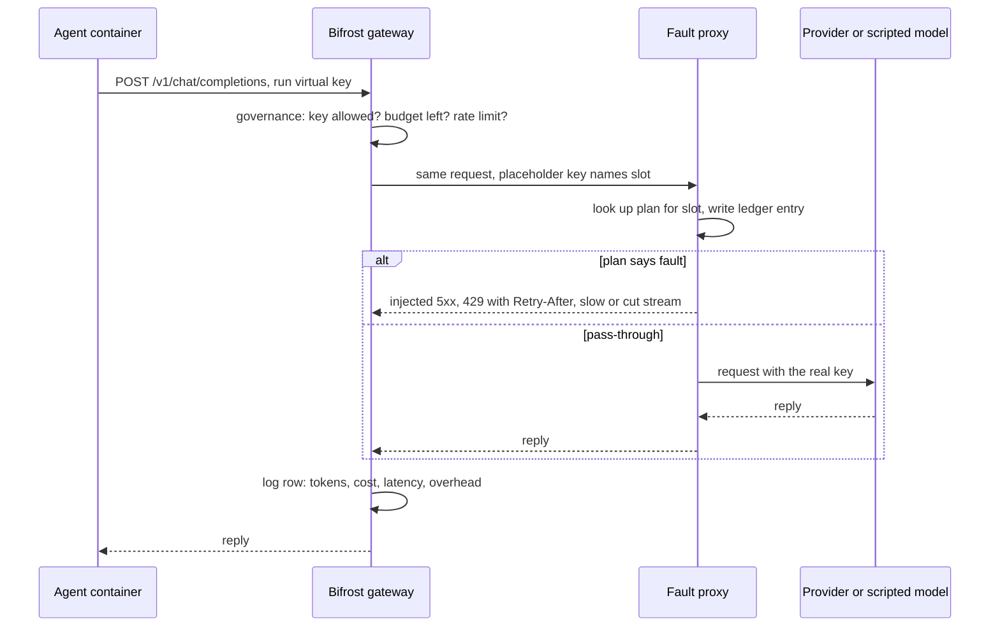
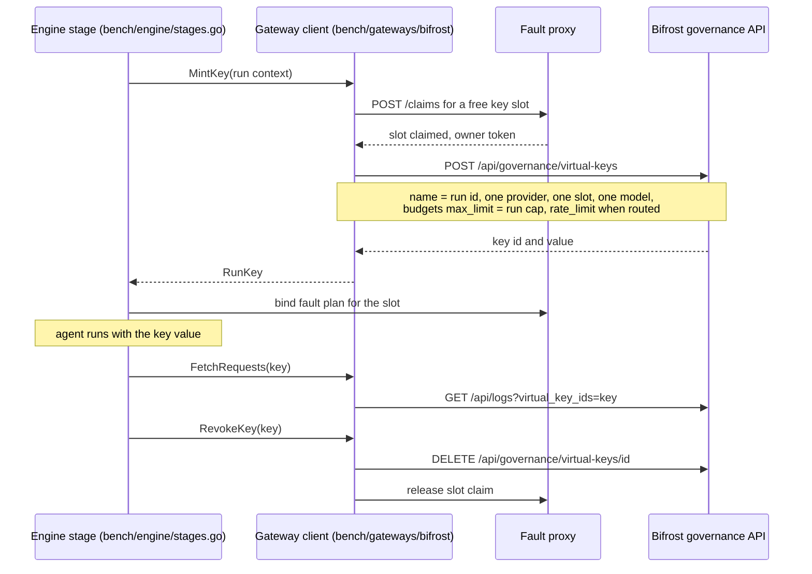
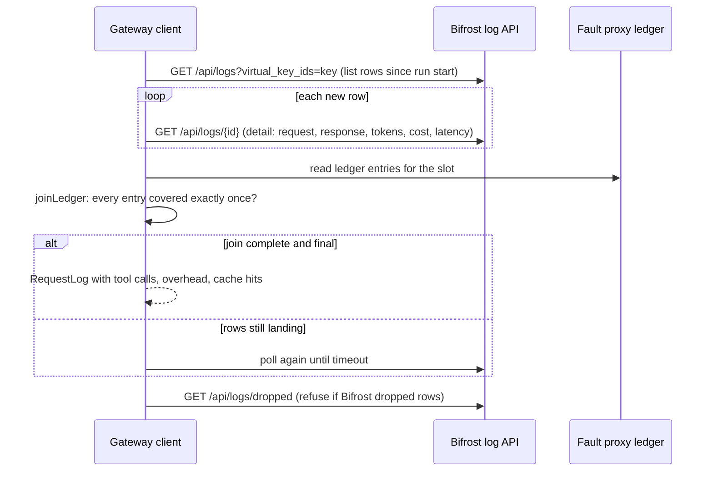
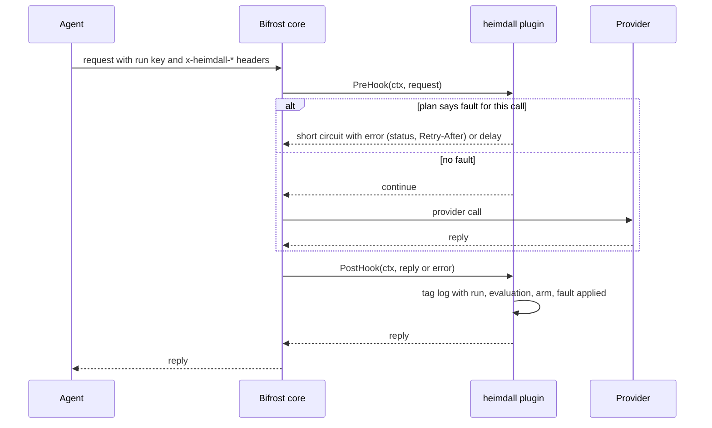
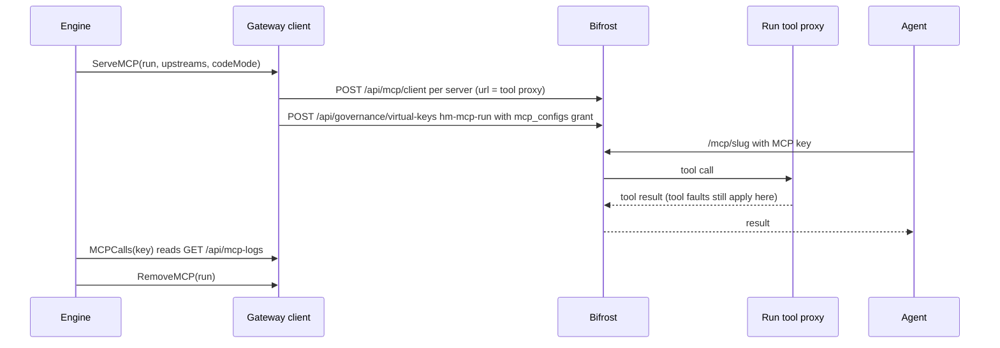

# How Heimdall uses Bifrost

Status: updated 22 Nov 2026. Every touchpoint below names the file that
implements it. The Wave C features (heimdall plugin, usage export, plugin
faults, per-evaluation budgets, failover, cache on vs off, MCP route, the
Through Bifrost panel) are merged.

Heimdall compares two setups of an AI agent on the same tasks and ends in a
verdict. Bifrost is not an add-on here: every model call an agent makes goes
through a Bifrost gateway, Bifrost's governance is how each run is isolated
and capped, and Bifrost's log is the trace of record. This page walks every
place Heimdall touches Bifrost, in the order a run meets them.

Feature-level detail (what Bifrost v2.5.1 can vary per arm and how each claim
was checked) is in [bifrost-features.md](bifrost-features.md). Routing policy
experiments are in [routing-experiments.md](routing-experiments.md).

## Map of touchpoints

| Touchpoint | What Heimdall does with Bifrost | Bifrost API or feature | Heimdall code |
|---|---|---|---|
| Gateway client | Talks to a stock Bifrost over its HTTP management API with the setup token | `X-Bifrost-Setup-Token`, `/api/providers`, `/api/config`, `/api/version` | `bench/gateways/bifrost/bifrost.go` (`New`, `Setup`, `ensureProvider`), `client.go` (`call`, `callRaw`) |
| Provider key slots | Registers each provider with a fixed pool of placeholder keys ("key slots"); a proxied provider's base URL is the fault proxy | `POST/PUT /api/providers` | `bifrost.go` (`setupProvider`, `providerBody`), `teamslots.go`, `slotclaims.go` |
| Org credentials (hosted) | Per lease, registers slots `org_<org>_<provider>_<n>` with placeholders; the real key goes only to the fault proxy | `/api/providers/{name}` | `bench/gateways/bifrost/orgcreds.go` (`ApplyOrgCredentials`), `bench/engine/remotecreds.go` |
| Virtual key per run | One governance virtual key per run, limited to one provider, one slot, one model | `POST /api/governance/virtual-keys` | `keys.go` (`MintKey`), called from `bench/engine/stages.go` |
| Governance budgets | The run's fairness cap is a hard Bifrost budget on its key (`budgets: [{max_limit, reset_duration: 1w}]`) | virtual key `budgets` | `keys.go` (`MintKey`, `runBudget`), `team.go` (`budgetReset`) |
| Team budgets | Multi-agent runs: one key per member, a Bifrost team budget over all of them | `POST /api/governance/teams` | `team.go` (`MintMemberKeys`, `createTeam`), `bench/engine/team.go` |
| Rate limits | A routing policy's limits become the routed key's `rate_limit` | virtual key `rate_limit` | `routing.go` (`routedKeyBody`) |
| Key cleanup | Revokes the run key at the end; a janitor revokes leftovers whose names match run ids only | `DELETE /api/governance/virtual-keys/{id}` | `keys.go` (`RevokeKey`, `RevokeStale`), `bench/engine/janitor.go` |
| Routing rules | A routing policy under test becomes one routing rule scoped to the run's key | `/api/governance/routing-rules` | `routing.go` (`applyRouteRule`, `revokeStaleRules`) |
| Routing export | Turns a model switch evaluation into a Bifrost routing config fragment, or applies it to the org's own Bifrost | routing rules, `config.json` | model switch evaluation (lane Z21) |
| Logs as the trace | Reads the run's rows, joins them call for call with the fault proxy ledger | `GET /api/logs`, `/api/logs/{id}`, `/api/logs/dropped` | `logs.go` (`FetchRequests`), `detail.go`, `detailopenai.go`, `join.go` |
| Gateway overhead | Splits every call's latency into gateway time and provider time | detail row `overhead_latency`, `upstream_latency`, `overhead_breakdown` | `bifrostfeatures.go` (`featureFields`) |
| Prompt cache | An arm can turn Bifrost's auto prompt caching on per request | header `x-bf-prompt-cache-auto-inject`, provider `prompt_cache` block | `bench/adapters/bifrostfeatures.go`, `bench/engine/bifrostfeatures.go`, `bifrostcache.go` (`PromptCacheConfigured`) |
| Semantic cache | An arm can engage Bifrost's `semantic_cache` plugin with a per-run cache key | header `x-bf-cache-key`, `cache_debug` in the log | `bench/adapters/bifrostfeatures.go`, `bench/engine/bifrostfeatures.go` |
| MCP gateway | An arm can route the task's MCP servers through Bifrost; tool calls show in Bifrost's MCP log | `POST /api/mcp/client`, `/mcp/<slug>`, `GET /api/mcp-logs` | `bifrostmcp.go` (`ServeMCP`, `RemoveMCP`, `MCPCalls`) |
| Agent gateway (a2a) | Registers a2a agents and reads their history | `/api/agents`, `/api/agents/history` | `a2a.go`, `bench/engine/a2a.go` |
| Complexity router | Reads the analyzer state before a routed run | `/api/routing/complexity-analyzer-status`, `/api/routing/model-routers` | `bifrostcache.go` (`ComplexityAnalyzerState`), `hygiene.go` |
| Preflight and hygiene | Flags a gateway whose semantic cache, routing rules, model routers or MCP tool injection could change traffic unseen | `/api/plugins`, `/api/plugins/loaded`, `/api/mcp/clients`, routing rules | `preflight.go` (`Preflight`), `hygiene.go` (`checkHygiene`) |
| Prompt log policy | Per org, sets whether Bifrost stores prompt content on the run key | virtual key log fields | `orglogs.go` (`SetExperimentLogPolicy`, `addLogFields`) |
| Failure inbox | Reads Bifrost logs as one source of failed traces to turn into tasks | `GET /api/logs` | `bench/traceinbox/bifrostsrc.go` |
| Gateway config | The stock gateway's config: auth on inference, logging on, no direct keys, Postgres stores, local pricing sheet | `config.json` | `bench/deploy/bifrost/config.json`, `bench/deploy/bifrost/datasheet/` |
| Heimdall plugin | A real Bifrost plugin: reads Heimdall run headers, injects faults in PreHook, tags responses in PostHook | Bifrost plugin interface (`core/schemas`) | `plugins/heimdall/` loading in `transports/bifrost-http/server/plugins.go` and `plugin_heimdall.go`, opt-in config `bench/deploy/bifrost/config.plugin.json` |
| Usage export | The plugin posts per-request usage to Heimdall | `POST /api/bench/gateway/usage` | `plugins/heimdall/usage.go`, `bench/handlers/gatewayusage.go` |
| Per-evaluation keys | One virtual key per evaluation with the evaluation's budget as a hard Bifrost budget | governance virtual keys | `bench/gateways/bifrost/evalbudget.go` |
| Fallbacks | "Provider failover" option: Bifrost fallbacks plus an injected primary outage | request `fallbacks` | `bench/failover/`, `bench/handlers/evalfailover.go`, `bench/reportcard/failover.go` |
| Cache as a variable | "Bifrost cache on vs off" with two arms that differ only in the cache | `semantic_cache` plugin | `bench/bifrostfeatures/cacheab.go`, `bench/handlers/evalcacheab.go` (`GET /evaluations/{id}/bifrost/cache`) |

## 1. The call path

Every model call goes agent, Bifrost, fault proxy, provider. The agent holds
only its run's virtual key. Bifrost holds only placeholder provider keys; the
placeholder names the key slot. The fault proxy (`bench/faultproxy`) reads
the slot, applies that slot's fault plan, swaps in the real key and forwards.
Clean runs take the same path with an empty plan, so clean and fault
conditions share one network path.

Why the agent can not bypass it: the agent container is on the evaluation
network only, where Bifrost is the one reachable service
(`bench/deploy/hosted/docker-compose.yml`, networks `evalnet` and `upstream`).
`enforce_auth_on_inference: true` and `allow_direct_keys: false` in
`bench/deploy/bifrost/config.json` mean a call without a run key is refused,
and an agent can not send its own provider key.

## 2. A run's virtual key and budget

- `MintKey` in `bench/gateways/bifrost/keys.go` builds the key body. When the
  run has a cap (`runBudget`), the key gets
  `budgets: [{"max_limit": <usd>, "reset_duration": "1w"}]`, so Bifrost
  itself stops the run at the cap. A routing policy may carry its own
  `budget_usd`; the two are never both applied (the planner refuses it).
- Team runs (`bench/gateways/bifrost/team.go`) put a Bifrost team budget over
  every member key, and a sub-budget on each member key, so the log says
  which member made each call and a fault can target one member.
- Slot claims (`bench/gateways/bifrost/slotclaims.go`,
  `bench/faultproxy/claims.go`) stop two bench processes sharing one gateway
  from taking the same slot: claim before mint, TTL 60 s renewed every 20 s.
- `RevokeStale` touches only keys whose names match the run id pattern, so
  a Bifrost shared with other users never loses their keys.

## 3. Logs are the trace of record

- `logs.go` (`FetchRequests`, `snapshot`) polls until the row set is final;
  `detail.go` and `detailopenai.go` parse tool calls out of raw request and
  response bodies, streamed or not; `join.go` matches each row to the proxy
  ledger, so a call that reached the provider but is missing from Bifrost's
  log (or the other way) marks the run's trace incomplete instead of passing
  silently.
- `bifrostfeatures.go` (`featureFields`) keeps `overhead_latency`,
  `upstream_latency`, `overhead_breakdown`, the complexity tier of a routed
  call and the cache hit type from `cache_debug`.
- `bench/traceinbox/bifrostsrc.go` reads the same log API to feed the
  failure inbox, so a team's own Bifrost traffic can become tasks.

## 4. Faults

Today faults are applied by Heimdall's fault proxy, which sits behind Bifrost
as the provider base URL. Plan modes (`bench/faultproxy/plan.go`): `none`,
`persistent`, `once`, `scripted`, `stream_cut`, `replay`, `slow`, `flaky`
and `budget_squeeze`, with fields such as `status`, `retry_after_s`,
`from_call`, `calls`, `until_s`, `fail_prob`, `delay_ms` and `model`.

**The heimdall plugin.** `plugins/heimdall` is a
Bifrost plugin module like `plugins/governance` or `plugins/mocker`. It reads
Heimdall's per-request context from headers (`x-heimdall-run-id`,
`x-heimdall-eval-id`, `x-heimdall-org`, `x-heimdall-arm`,
`x-heimdall-fault-plan-id`, plan in `x-heimdall-fault-plan`), applies the
same fault modes in PreHook, and in PostHook marks the response with
`x-heimdall-fault-applied` and the Heimdall ids. It is registered as a
built-in plugin in `transports/bifrost-http/server/plugins.go`
(`plugin_heimdall.go`). The bench's fault mode `plugin`
(`bench/gateways/bifrost/pluginfaults.go`, `HEIMDALL_FAULT_MODE`) sends plans
as headers instead of writing them to the proxy, for agents known to carry
the headers; the proxy stays as the fallback.

**Custom Bifrost build with the Heimdall plugin.** The stock
`maximhq/bifrost` image has no heimdall plugin, so the default
`bench/deploy/bifrost/config.json` has no heimdall entry. The plugin is
opt-in: `bench/deploy/bifrost/config.plugin.json` is the same config with
the `heimdall` plugin enabled, `allow_inline_plans` on and usage posted to
`http://heimdall:8090` with `env.HEIMDALL_GATEWAY_USAGE_SECRET`, and
`bench/deploy/hosted/docker-compose.bifrost-plugin.yml` builds Bifrost from
this repo (`transports/Dockerfile`, context the repo root) and mounts it
(`docs/hosting.md`, same heading). A local end to end check is in
`bench/deploy/bifrost/e2e/`.

Trade-off: the plugin puts faults inside Bifrost, so they show in Bifrost's
own log next to the call, and no extra hop is needed. The proxy stays the
only place that holds real provider keys and writes the spend ledger, which
is why the proxy path remains the default until the plugin path has passed
the same ledger join.

**Usage export.** `plugins/heimdall/usage.go`
batches one record per request (run id, provider, model, tokens, cost,
latency, cache hit, fallback used, fault applied) and posts it with a shared
secret to `POST /api/bench/gateway/usage` (`bench/handlers/gatewayusage.go`).
The run page's "Through Bifrost" panel (`GET /runs/{id}/bifrost`,
`bench/handlers/runbifrost.go`) shows those records, preferring them when
present, next to the log rows; the report card has a short Bifrost section.

## 5. Caching and MCP as arms

An arm can vary a Bifrost setting only if Bifrost applies it per virtual key
or per request. The arm's `gateway.bifrost` block is checked by the planner
(`bench/engine/bifrostfeatures.go`) and turned into request headers by the
adapter (`bench/adapters/bifrostfeatures.go`):

- `prompt_cache`: header `x-bf-prompt-cache-auto-inject: true|false`. The
  planner refuses it on a provider whose Bifrost config has no
  `prompt_cache` block (`PromptCacheConfigured` in `bifrostcache.go`),
  because Bifrost would silently ignore the header.
- `semantic_cache`: header `x-bf-cache-key` built from the run, so entries
  are not shared across runs by accident. Hits are read back from
  `cache_debug` in the log. The evaluation option "Bifrost cache on vs off"
  (`EvaluationSpec.bifrost_cache`) adds a cache-on copy of the one arm;
  `GET /evaluations/{id}/bifrost/cache` reports hit rate, latency and cost
  saved and success change per benchmark, shown on the evaluation page.
- `mcp`: `ServeMCP` in `bifrostmcp.go` creates one Bifrost MCP client per
  task MCP server, pointed at the run's tool proxy, grants it to a separate
  MCP key (`hm-mcp-<run>`) only, and removes both at cleanup. Tool calls are
  then read from `GET /api/mcp-logs` as a second witness next to the tool
  proxy ledger (`MCPCalls`). The evaluation option `mcp_route` (`bifrost`
  or `bifrost_code_mode`) routes every arm's MCP tools this way.

## 6. Routing and the routing export

- Routing policy under test (`bench/gateways/bifrost/routing.go`): a run
  whose agent config has `gateway.routing` gets a key that allows every
  model of the policy on its one slot, the policy's governance limits
  (`rate_limit`, budget), and one routing rule scoped to that key
  (`scope: virtual_key`). Stale rules are removed by name prefix.
- Routing export (Z21): a model switch evaluation runs one agent on several
  models and writes the winning choice as Bifrost routing config, downloadable
  as a `config.json` fragment or applied to the org's own Bifrost. This is how a result in
  Heimdall becomes a change in production Bifrost.

## 7. Budgets per evaluation and failover

- Per-evaluation budget (`bench/gateways/bifrost/evalbudget.go`): one Bifrost virtual key per evaluation with the evaluation's
  budget as a hard Bifrost budget (and a rate limit); runs use it or per-run
  keys under it; revoked at the end. A run stopped by Bifrost's budget shows
  as "stopped by Bifrost budget".
- Provider failover (`bench/failover/`, `bench/handlers/evalfailover.go`): the "Provider failover" option configures Bifrost fallbacks for
  the agent's model and injects an outage on the primary (through the
  heimdall plugin when present, else the fault proxy). The report says
  whether failover worked, the extra latency, the cost change, and task
  success with and without.

## 8. Guarding the measurement

Heimdall treats Bifrost as a measuring instrument, so before a run it checks
that nothing on the gateway can change traffic unseen
(`bench/gateways/bifrost/preflight.go`, `hygiene.go`):

- `GET /api/plugins/loaded` and the plugin config: a loaded or enabled
  semantic cache is flagged, since a cached answer is not a model call; a
  `default_cache_key` would cache requests that send no key (`checkPlugins`).
- Enabled routing rules that can move a request (several targets,
  fallbacks, or a pinned provider, model or key) are flagged, except the
  run's own key-scoped policy rule (`checkRoutingRules`, `benchRule`);
  model routers with routing on are flagged too (`checkModelRouters`).
- MCP clients are allowed only with `mcp_disable_auto_tool_inject: true`,
  so no request silently carries the gateway's tools (`checkMCP`).
- Each provider's key slots and base URL must match the setup, and no
  provider may inject tools (`checkProviderHygiene`); an egress probe checks
  the agent can reach only Bifrost (`probeEgress`).
- `GET /api/logs/dropped` must stay at zero during a run.

## 9. Where Bifrost runs

- Hosted: `bench/deploy/hosted/docker-compose.yml`, services `bifrost`
  (image `maximhq/bifrost:v2.5.1` pinned by digest), `bifrost-postgres`
  and `faultproxy`, in profiles `demo-runner` and `shared-runner`. Each
  runner brings its own gateway stack.
- Local: `bench/deploy/docker-compose.yml`, Bifrost on 127.0.0.1 port 18080,
  agents reach it as `http://bifrost:8080` (`bench/deploy/bench.yaml`).
- Gateway config for both: `bench/deploy/bifrost/config.json`.
